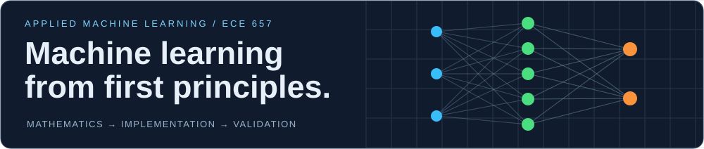
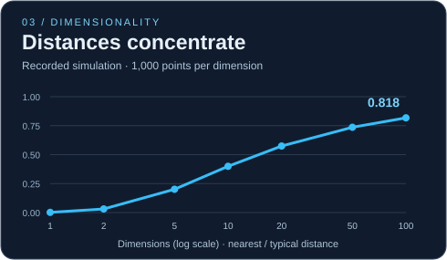
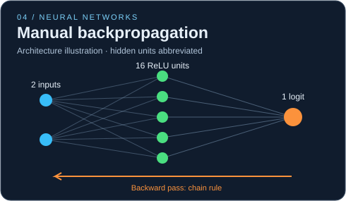
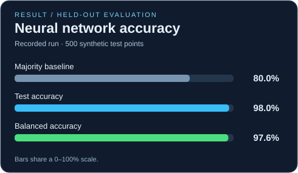
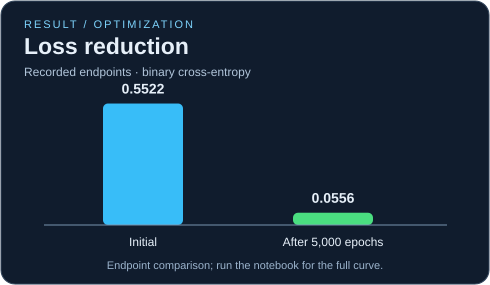

# Machine Learning | From First Principles

<p align="center"></p>

<p align="center"><strong>Python · NumPy · JAX · SciPy · scikit-learn · Jupyter</strong></p>

**Silas Ifeanyi · Engineering & Applied Machine Learning**

A collection of machine learning studies motivated by graduate coursework in ECE 657 at the University of Waterloo. The emphasis is on understanding the mathematics, implementing algorithms, and validating their behavior rather than treating libraries as black boxes.

> Portfolio reproductions are newly prepared, AI-assisted extensions of the original coursework. The historical work and new validation results are distinguished below; these are not claims of original course grades or production deployment.

## Visual project gallery

<p align="center"><a href="notebooks/01-classification.ipynb"></a> <a href="notebooks/02-optimization.ipynb"></a></p>
<p align="center"><a href="notebooks/03-dimensionality.ipynb"></a> <a href="notebooks/04-neural-network.ipynb"></a></p>

Click a figure to open the corresponding notebook. Architecture and algorithm diagrams are illustrative; the dimensionality plot uses the recorded metrics.

## Projects at a glance

| Study | Core concepts | Verified portfolio result |
|---|---|---|
| [01 — Classification from scratch](projects/01-classification.md) | Euclidean distance, majority voting, feature scaling, held-out evaluation | 97.9% test accuracy; 100% agreement with scikit-learn |
| [02 — Optimization and decision trees](projects/02-optimization.md) | Penalized log-likelihood, L1/L2 gradients, Gini impurity | Analytical gradient agrees with finite differences |
| [03 — Curse of dimensionality](projects/03-dimensionality.md) | Distance concentration, data sparsity, simulation | Nearest-to-typical distance ratio grows from 0.002 to 0.818 (1–100 dimensions) |
| [04 — Neural networks from first principles](projects/04-neural-network.md) | JAX, ReLU, sigmoid, manual backpropagation, automatic differentiation | 98.0% held-out accuracy; gradient error ~1.04 × 10⁻⁷ |

## Interactive notebooks

Open these notebooks in GitHub or run them in Jupyter after installing the dependencies. Each walks through the question, mathematics, implementation, validation and interpretation.

| Notebook | Focus |
|---|---|
| [01 · Classification](notebooks/01-classification.ipynb) | Compare NumPy k-NN with scikit-learn |
| [02 · Optimization](notebooks/02-optimization.ipynb) | Derive and verify gradients; Gini gain |
| [03 · Dimensionality](notebooks/03-dimensionality.ipynb) | Explore distance concentration |
| [04 · Neural network](notebooks/04-neural-network.ipynb) | Derive backpropagation and visualize nonlinear classification |

```bash
python -m pip install jupyterlab
jupyter lab
```

## Featured: neural network validation

<p align="center"> </p>

A two-layer neural network learns a circular classification boundary from synthetic data. The manually derived gradients are checked against JAX automatic differentiation. The [notebook](notebooks/04-neural-network.ipynb) generates the full training curve and learned decision boundary when run. The charts above are drawn only from the [recorded metrics](results/metrics.json).

## What this portfolio demonstrates

- **Mathematical foundations:** distance metrics, likelihood, regularization, impurity and the chain rule.
- **Algorithm implementation:** nearest-neighbor voting, analytical gradients and explicit neural-network forward/backward passes.
- **Experiment design:** seeded simulations, separate training and test data, training-only feature scaling and comparative baselines.
- **Verification:** numerical gradient checks, comparison with a reference library, automated tests and documented limitations.
- **Tools:** Python, NumPy, SciPy, JAX, scikit-learn, Matplotlib and pytest.

## Reproduce the results

Python 3.11 or newer recommended; CPU is sufficient. No credentials, external training downloads or GPU are required.

```bash
python -m venv .venv
# Windows PowerShell: .venv\Scripts\Activate.ps1
# macOS/Linux: source .venv/bin/activate
python -m pip install -r requirements.txt
python run.py
python -m pytest -q
```

The run creates [metrics.json](results/metrics.json) and the figures in `results/`. Four automated tests passed in the recorded portfolio run. Small numerical differences may occur across platforms and library versions. The [tested environment](results/environment.txt) records the versions actually used.

## Provenance and scope

The source is graduate ECE 657 coursework (kept separately). The original work includes a NumPy k-NN function, penalized logistic-regression calculations, a Gini split comparison, a nearest-neighbor dimensionality simulation, and a JAX exercise with manual backpropagation. The portfolio independently reconstructs these methods, corrects the binary cross-entropy sign error in the original notebook, and adds tests, holdout metrics, figures and a reference comparison. The RNN music-generation template and a starter Wine dataset script are excluded because the available files do not establish completed implementations. No instructor assignment handouts, credentials or original course notebooks are redistributed here.

See [CHANGELOG.md](CHANGELOG.md) for the initial portfolio changes.