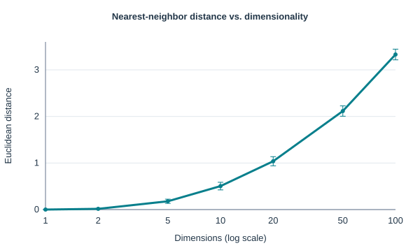

# 03 | Curse of dimensionality

[Back to portfolio](../README.md) · [Implementation](fundamentals.py) · [Metrics](../results/metrics.json)

## Question
Why can nearest-neighbor approaches become less informative when the number of features increases?

## Experiment
The original coursework generated 1,000 uniformly distributed samples in unit hypercubes, calculated Euclidean pairwise distances, excluded self-distances, and plotted the mean and standard deviation of nearest-neighbor distances. The new reproduction uses the same seeded approach and adds a scale-relative statistic: mean nearest-neighbor distance divided by median pairwise distance.

| Dimensions | Mean nearest distance | Relative to typical pair distance |
|---:|---:|---:|
| 1 | 0.00050 | 0.002 |
| 10 | 0.504 | 0.399 |
| 50 | 2.116 | 0.736 |
| 100 | 3.330 | 0.818 |

## Interpretation and limitations
With a fixed sample count, points become increasingly sparse in a high-dimensional cube. Even the closest point becomes more similar in distance to a typical point. This helps explain the need for feature selection, meaningful metrics and dimensionality reduction in engineering sensor datasets. The experiment is limited to independent uniform features, fixed sample count, Euclidean geometry and one random seed; real datasets can have lower intrinsic dimension. The full distance matrix also requires quadratic memory.