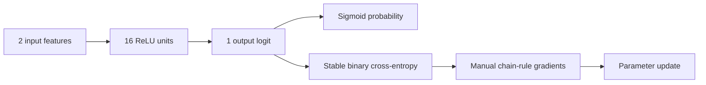
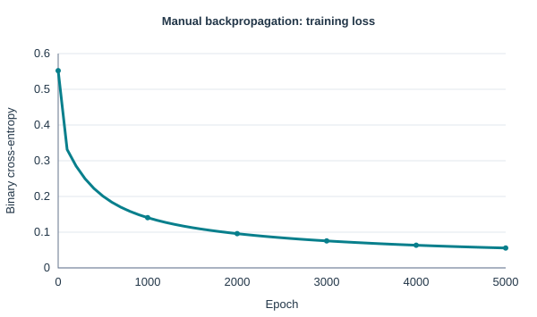

# 04 | Neural networks from first principles

[Back to portfolio](../README.md) · [Implementation](neural_network.py) · [Tests](../tests/test_algorithms.py)

## Question
Can a small network learn a nonlinear classification boundary using gradients derived by hand, and can those gradients be verified independently?

## Architecture and training
The original JAX coursework includes random parameter initialization, a ReLU hidden layer, sigmoid output and explicit backpropagation. It also contains a binary cross-entropy sign error in the displayed loss; the manual gradient corresponds to the usual binary cross-entropy instead. This reproduction fixes the objective using the stable logits form, softplus(z) − yz, checks gradients with JAX autodiff, and uses full-batch gradient descent with a learning rate of 0.1.

The forward pass is z₁ = XW₁ + b₁, a₁ = ReLU(z₁), z₂ = a₁W₂ + b₂. For binary cross-entropy, the output derivative is (sigmoid(z₂) − y)/n. The gradient flows backward through the second weight matrix and the ReLU mask. JAX autodiff is used as an independent reference, not to compute the training updates.

## Results — new portfolio reproduction
2,000 synthetic points, seed 42, stratified 75/25 training/test split, 5,000 training steps. Positive points lie inside a radius-0.5 circle.

| Metric | Value |
|---|---:|
| Initial → final training loss | 0.5522 → 0.0556 |
| Held-out samples | 500 |
| Test accuracy | 98.0% |
| Test balanced accuracy | 97.63% |
| Majority-class baseline accuracy | 80.0% |
| Maximum absolute gradient discrepancy | 1.04 × 10⁻⁷ |

## Interpretation and limitations
The learned nonlinear boundary approximates the circle with piecewise linear regions. Balanced accuracy guards against interpreting high majority-class accuracy as learning. The model uses a simple synthetic dataset and one seed; the result is not evidence of performance on industrial data. A stronger study would use a validation split for architecture selection and report repeated-seed results.